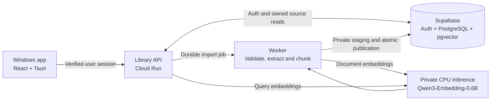

# Gather

Find saved information by meaning, without remembering exact filenames.

Gather is a Windows knowledge library with a unified collection, cloud-powered
semantic search and citations back to the exact saved source.

**Status — 4 November 2026:** working, restricted private pilot. Selected
TXT/Markdown, native-text PDF and DOCX flows have been verified against the
hosted backend and Windows app. Public signup and production distribution are
not released. The separate default design preview uses fictional sample data.

**Current implementation:** [`codex/durable-ingestion-jobs`](https://github.com/kratos1911/gather-desktop/tree/codex/durable-ingestion-jobs).
The default `main` branch is an earlier baseline; use the implementation branch
for the current source, setup scripts and linked documentation.

## What works today

| Capability | Implemented and verified scope |
| --- | --- |
| One connected Library | Sign in, load owned sources, filter files and restore the saved collection after signing in again. Credentials remain in memory. |
| TXT and Markdown | Select a UTF-8 file, review it locally, explicitly save it and process it automatically. |
| Native-text PDFs | Extract selectable text with page references; preserve the immutable original and exact saved version. |
| Word documents | Extract supported DOCX main-body text, including table-cell paragraphs, with paragraph citations. |
| Reliable processing | Durable jobs, idempotent submission, bounded claims/leases/retries, truthful states and explicit failure recovery. |
| Semantic search | Use matching pinned document/query embeddings, retrieve published passages and assemble bounded source context. |
| Source-grounded reading | Open the exact owned published version; show text offsets, PDF pages or extracted DOCX paragraphs. |
| Deletion and cleanup | Hide deleted sources immediately, prevent stale publication and report physical cleanup as complete only after confirmation. |
| Windows delivery | Built the native executable and unsigned installer; verified installation, sign-in, restoration, opening and installer lifecycle on the development PC. |

The connected Windows build uses hosted services. End users do not need a local
API server, Python, Node.js or downloaded model weights. Clean-machine acceptance
and release signing remain open.

## How it works



**Import → validate → save job → extract/chunk → embed → publish → search → open → delete.**

- The API and private model service run on Google Cloud Run in Mumbai. Supabase
  in Sydney currently holds authentication, originals, jobs, metadata and vectors.
- Document and query embeddings share a pinned model revision and 512-dimensional
  space. Model execution stays in the cloud.
- Only a complete, validated version becomes searchable. Replacement processing
  preserves the previous published version until the new version is ready.
- Ownership is enforced through verified sessions and database/API checks.
  The frontend receives neither privileged database credentials nor Google caller tokens.
- Cancelled, expired, deleted or superseded work cannot publish late results.
  Embedding requests are never automatically replayed after an uncertain failure.

See the [architecture](https://github.com/kratos1911/gather-desktop/blob/codex/durable-ingestion-jobs/docs/ARCHITECTURE.md), [publication contract](https://github.com/kratos1911/gather-desktop/blob/codex/durable-ingestion-jobs/docs/TEXT_PUBLICATION.md)
and [security boundaries](https://github.com/kratos1911/gather-desktop/blob/codex/durable-ingestion-jobs/docs/SECURITY.md) for details.

## Technology

| Layer | Current implementation |
| --- | --- |
| Desktop | Tauri 2 / Rust shell, React 19, TypeScript, Vite |
| API and processing | Python, ASGI, bounded background processing and disposable parser helpers |
| Authentication and storage | Supabase Auth, PostgreSQL and pgvector; private originals/staging |
| Embeddings | Self-hosted Qwen/Qwen3-Embedding-0.6B, CPU inference, 512 dimensions |
| Hosting | Google Cloud Run and Artifact Registry |
| Verification | Vitest / Testing Library, Python unittest, isolated SQL acceptance checks and selected native/cloud flows |

R2 originals, additional formats and bookmark enrichment are planned rather than
the current deployed storage/import implementation.

## Progress and evidence

- **Connected Windows/cloud flow:** sign in → select/review/save → automatic
  ready → custom semantic search → exact saved text. Supported deletion/cleanup
  was also verified through the app.
- **DOCX milestone:** the generated test document reached ready on attempt 1.
  Search and paragraph-cited opening passed with exactly two real embedding
  requests: one document request and one query request. A subsequent compatibility
  correction accepted a standard-producer Word fixture without further inference.
- **Focused verification:** 74 frontend checks, an affected Linux backend run of
  112 checks, 23 final parser-image checks and 13 SQL acceptance groups passed
  for the DOCX milestone, alongside frontend/native/installer builds. Groups
  overlap and must not be added into one unique test count. Synthetic checks
  and live semantic evidence are distinguished in the linked notes.
- **Measured warm-path improvement:** in a four-run comparison on the same small
  generated PDF, worker time fell from approximately 39–41 seconds to 18–19
  seconds; observed ready time fell from about 61 seconds to 33–35 seconds.
  In-job database connections fell from 12 to 2. These are fixture measurements,
  not cold-start, large-document or p95 guarantees.

Detailed evidence: [DOCX](https://github.com/kratos1911/gather-desktop/blob/codex/durable-ingestion-jobs/docs/DOCX_IMPORT.md), [PDF](https://github.com/kratos1911/gather-desktop/blob/codex/durable-ingestion-jobs/docs/PDF_IMPORT.md),
[private text files](https://github.com/kratos1911/gather-desktop/blob/codex/durable-ingestion-jobs/docs/PRIVATE_TEXT_FILES.md), [processing performance](https://github.com/kratos1911/gather-desktop/blob/codex/durable-ingestion-jobs/docs/PROCESSING_SPEED.md),
[Windows install QA](https://github.com/kratos1911/gather-desktop/blob/codex/durable-ingestion-jobs/docs/WINDOWS_INSTALL_QA.md) and [progress journal](https://github.com/kratos1911/gather-desktop/blob/codex/durable-ingestion-jobs/docs/PROGRESS.md).

## Current limits and remaining work

- Access is restricted to two existing pilot accounts; this is not a public service.
- Original files and extracted text are bounded to 64 KiB, with at most three
  processing passages. Additional parser and request limits apply.
- PDFs require selectable text on every page, with at most 20 pages. Scanned
  documents, OCR and image indexing are not implemented.
- DOCX support covers a bounded subset of main-body text, not Word page layout,
  images or universal Office compatibility. Legacy DOC, active/ambiguous content
  and unsupported packages are rejected. Expanded archives are capped at 1 MiB
  total and 512 KiB per member.
- Cold starts and broader performance remain limitations. Failed processing
  requires explicit recovery within existing attempt limits.
- The installer is unsigned. A clean Windows environment, cross-version upgrades,
  broader accessibility/security/dependency review and public-release gates remain open.
- **Next:** safe links/bookmarks in the same Library. PPTX, photo/OCR retrieval
  and broader quality evaluation remain planned; chat is deferred.

Current scope and release gates: [MEMORY](https://github.com/kratos1911/gather-desktop/blob/codex/durable-ingestion-jobs/docs/MEMORY.md), [TASKS](https://github.com/kratos1911/gather-desktop/blob/codex/durable-ingestion-jobs/TASKS.md)
and [privacy/release audit](https://github.com/kratos1911/gather-desktop/blob/codex/durable-ingestion-jobs/docs/PRIVACY_RELEASE_AUDIT.md).

## Run and develop

### Sample UI preview

From the repository root in PowerShell, with a supported Node.js runtime installed:

```powershell
git switch codex/durable-ingestion-jobs
.\scripts\desktop.ps1 install
.\scripts\desktop.ps1 preview
```

Open [localhost:1420](http://localhost:1420/). This default preview is sample-only;
it does not establish a live account, upload a document or run semantic inference.
Use the runtime helper rather than an outdated Node installation on PATH.

### Connected private build

The private Windows app uses the configured hosted API and existing allowed
accounts. A fresh clone does not include operator credentials, private configuration,
model caches or built installers, and does not automatically provision cloud services.
See [private desktop delivery](https://github.com/kratos1911/gather-desktop/blob/codex/durable-ingestion-jobs/docs/PRIVATE_DESKTOP_DELIVERY.md) and
[hosted setup](https://github.com/kratos1911/gather-desktop/blob/codex/durable-ingestion-jobs/docs/HOSTED_SUPABASE_SETUP.md) before configuring a connected build.
Native development also needs the Tauri Windows prerequisites.

### Focused checks

```powershell
.\scripts\python.ps1 -m unittest tests.worker.test_docx_processing -q
.\scripts\desktop.ps1 test
.\scripts\desktop.ps1 build
```

Select checks appropriate to the change from the [test plan](https://github.com/kratos1911/gather-desktop/blob/codex/durable-ingestion-jobs/docs/TEST_PLAN.md).
Model benchmarks, isolated database tests and paid cloud operations are explicit
tasks, not prerequisites for every edit.

## Repository guide

- [Project hub / Obsidian navigation](https://github.com/kratos1911/gather-desktop/blob/codex/durable-ingestion-jobs/docs/PROJECT_HUB.md)
- [Product requirements](https://github.com/kratos1911/gather-desktop/blob/codex/durable-ingestion-jobs/docs/PRD.md) and [current architecture](https://github.com/kratos1911/gather-desktop/blob/codex/durable-ingestion-jobs/docs/ARCHITECTURE.md)
- [Current state](https://github.com/kratos1911/gather-desktop/blob/codex/durable-ingestion-jobs/docs/MEMORY.md), [task register](https://github.com/kratos1911/gather-desktop/blob/codex/durable-ingestion-jobs/TASKS.md) and [decisions](https://github.com/kratos1911/gather-desktop/blob/codex/durable-ingestion-jobs/docs/DECISIONS.md)
- [Working instructions](https://github.com/kratos1911/gather-desktop/blob/codex/durable-ingestion-jobs/AGENTS.md) and [development workflow](https://github.com/kratos1911/gather-desktop/blob/codex/durable-ingestion-jobs/RULES.md)
- [File retention policy](https://github.com/kratos1911/gather-desktop/blob/codex/durable-ingestion-jobs/docs/FILE_AUDIT.md) and [historical snapshots](https://github.com/kratos1911/gather-desktop/blob/codex/durable-ingestion-jobs/docs/history/README.md)

Keep private documents, credentials, models and build outputs out of Git.
Historical prototypes in [legacy](https://github.com/kratos1911/gather-desktop/blob/codex/durable-ingestion-jobs/legacy/README.md) are not the current app and
must not be run against personal documents. Preserve dependency licences and provenance.
