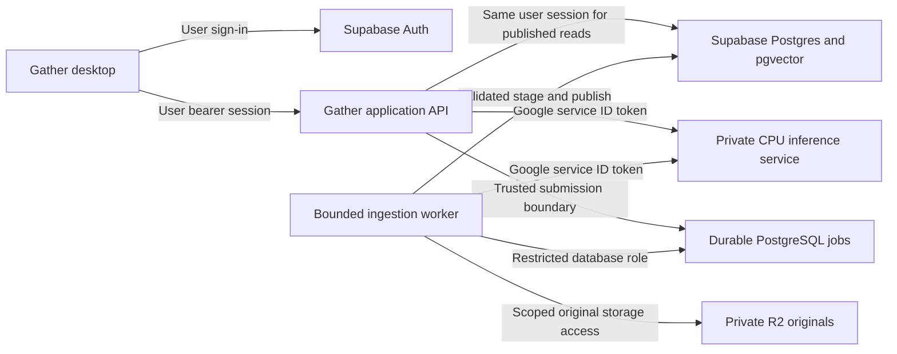

# Cloud Run hosting and identity design

17 October 2026. Reviewed implementation plan, NOT deployed infrastructure.
No account, IAM, billing, service, secret or resource changes made. The prior
local evidence remains in TASKS.md; it is not cloud evidence.

## Target layout

The API and inference service are separate Cloud Run services. The desktop never
calls the model directly or holds service credentials. Durable job state stays
in PostgreSQL; do not add a competing Redis/queue ledger. R2 remains the chosen
original-storage target, not a vector database. Its adapter is not implemented.
The diagram represents the target, not a connected end-user flow.

Use one bounded Cloud Run Job execution for controlled ingestion pilot runs,
one task with parallelism one. Application job leases/retries remain authoritative;
avoid automatic platform retries compounding the three existing attempts.
Automated dispatch/reconciliation is a later explicit prerequisite: a stopped
scale-to-zero service cannot poll jobs. Do not launch background ingestion after
returning an HTTP response. Manual pilot execution is not release-ready dispatch.

## Two independent identity boundaries

1. **Person -> API/data:** Supabase user session, verified by Auth before expensive
   work. API derives owner from verified identity. Published database calls retain
   that user's session and RLS; a service-role key must not replace it. Privileged
   submission still needs its own verified-context driver boundary.
2. **API/worker -> model:** dedicated Google service accounts and short-lived
   Google-signed ID tokens, audience bound to the inference service URL. Grant
   `roles/run.invoker` on that service only to approved API/worker identities.
   No `allUsers` grant on inference, default broad service account or downloaded
   service-account JSON keys. Use the platform identity rather than the local
   shared bearer secret. See [Google service authentication](https://docs.cloud.google.com/run/docs/authenticating/service-to-service).

| Identity | Proposed authority | Explicitly absent |
| --- | --- | --- |
| API runtime account | Invoke model; only secrets required for approved admission | Deploy/admin, model-storage mutation, broad database bypass for search |
| Ingestion account | Invoke model; restricted job DB credential; scoped R2 access | IAM administration, other buckets/projects |
| Inference account | No Supabase/R2 credentials; only permissions required by the selected startup artifact strategy | User libraries, extraction tools, deployment rights |
| Deployer | Deployment permissions and ability to assign these runtime accounts | Credentials embedded in application/desktop |

Initial private-model routing proposal: HTTPS service URL reachable by authorized
callers, Cloud Run Invoker checking REQUIRED. This is IAM-private, not a claim of
network-internal ingress. Network-internal ingress requires an explicit compatible
VPC routing design; do not toggle it and assume service-to-service calls still work.
The user-facing API must accept end-user traffic while enforcing Supabase auth in
application code; enabling public ingress is gated until auth/quota tests pass.

Token acquisition/refresh is a new bounded adapter, not the current fixed-secret
InferenceClient. Cache only by service audience and credential expiry; never log
tokens. Reject acquisition failure rather than falling back to a static key.
Cloud IAM verifies invocation. The model API does not infer document ownership
from a Google token; the application/data boundaries remain responsible for that.

## Production runtime adaptation

Proposed server: FastAPI + Uvicorn, one web process and one existing Runtime child.
Use lifespan to load/close Runtime and readiness only after verified model load.
Offload blocking infer calls without blocking health handling; retain explicit
single-inference admission before scheduling work. Preserve all current request,
token, result and compute bounds. Pin/review dependencies before installation.
[FastAPI workers](https://fastapi.tiangolo.com/deployment/server-workers/) and
[lifespan](https://fastapi.tiangolo.com/advanced/events/) inform this choice.

Do not publish the standard-library loopback server by changing its bind address.
Implement the production entry point separately, with independently tested IAM
deployment policy, total receive deadline, bounded headers and shutdown handling.
Cloud Run expects ingress on `0.0.0.0:$PORT` and handles external TLS. Writable
filesystem data is ephemeral and consumes memory. See the
[container contract](https://docs.cloud.google.com/run/docs/container-contract).

Model artifact proposal: bake only the pinned, manifest-verified safetensors and
tokenizer into a private immutable image after licence review. Preserve offline
loading; no Hugging Face token or model download in the request path. Measure
image pull/startup before accepting this strategy. Registry storage/build/transfer
costs require approval too. Do not assume the local /model host mount exists in
Cloud Run, and do not download gigabytes into the writable memory filesystem.

## Proposed pilot configuration, not applied settings

| Setting | Starting proposal and reason |
| --- | --- |
| Model CPU / memory | 2 vCPU / 5 GiB: preserve the tested container budget; production adapter must pass within it |
| Model concurrency | 1 request per instance; one runtime child; no multiple model copies |
| Instances | Minimum 0, service-level maximum 1 for initial measurement only |
| Billing | Request-based pilot; no unattended/background model jobs |
| Application request bounds | Existing 5 s session I/O, 15 s inference client and 15 s model compute retained |
| Platform request timeout | Proposed 30 s outer guard; not a compute cancellation mechanism or client-budget increase |
| Startup | Existing 90 s runtime startup ceiling; readiness probe only after model is usable |
| Region | Undecided until latency, Supabase location, privacy and price review |

The CPU/memory pairing is permitted by Google's
[memory configuration](https://docs.cloud.google.com/run/docs/configuring/services/memory-limits).
It is a starting experiment, not measured cloud capacity. A platform timeout may
leave code executing: keep the runtime's own cancellation/termination. See
[request timeouts](https://docs.cloud.google.com/run/docs/configuring/request-timeout).
On shutdown, stop accepting work, signal cancellation and reap the child within
the platform shutdown allowance; test SIGTERM explicitly.

**Cold-start gate:** local model startup was about 14–16 seconds before HTTP
overhead; cloud startup is unmeasured. Minimum-zero plus a 15-second client limit
cannot promise reliable first-query success. Do not silently extend deadlines or
retry. The pilot must measure this, then choose a separately bounded warm-up flow
with honest UI states, improve startup, or approve paid warm capacity. A readiness
probe alone does not eliminate cold-start waiting. This decision blocks release,
not implementation of the production adapter.

Maximum instances reduces scaling but is not a strict spending cap and may be
briefly exceeded. Alerts-only budgets notify; they do not stop spending. Do not
assume eligibility for Google's separate spend-cap feature without checking the
actual project/services. Sources: [maximum instances](https://docs.cloud.google.com/run/docs/configuring/max-instances),
[budget types](https://docs.cloud.google.com/billing/docs/how-to/budgets).
Require explicit pilot spend approval, per-owner/global admission quotas, request
limits and a tested service-disable procedure before deployment. No monthly cost
or free-operation promise is made by this document.

## Ordered implementation and release gates

| Step | Deliverable | Acceptance |
| --- | --- | --- |
| 1, local implementation verified; Linux shutdown/image pending | Production ASGI adapter and lifecycle, no deployment | Existing client + synthetic Runtime tests; auth-boundary configuration fails closed; input/deadline/busy/SIGTERM behavior preserved; no extra model processes |
| 2, client/intended config locally verified; deployed policy and receiving auth pending | Managed ID-token client and declarative deployment policy | See CLOUD_IDENTITY.md; bounded acquisition, audience/expiry and no fallback tested with synthetic tokens. Actual IAM verification remains open |
| 3 | Reproducible image with verified model artifacts | Licence and current vulnerability review closed; hashes/digests pinned; real HTTP smoke, startup/RAM/shutdown measured under existing limits |
| 4, approval required | Isolated cloud pilot | Region/project/budget approved; negative IAM tests for anonymous/wrong identity/audience; permitted caller works; cold/warm latency/RAM/cost measured; rollback exercised |
| 5 | Connected ingestion and desktop flow | Verified private driver/owner propagation, dispatch/reconciliation, R2 quota/cleanup, secure desktop sessions, real import/search/open/delete; privacy/release gates pass |

Do not claim completion of step 5 from an inference endpoint test. Deploy by
immutable revision/image, test before shifting traffic; retain rollback revision.
Keep embedding model/revision/dimensions in the existing data contracts. A changed
model space requires separate versioned indexing, not in-place vector mixing.
Monitor counts/status, latency, memory, queue age and cost; exclude documents,
queries, vectors, tokens and original URLs from telemetry. No analytics added now.

## Open decisions reserved for deployment

Exact project/region and pilot spending cap, cold-start UX versus warm capacity,
final licence/security sign-off, hosted secret/DB connection mechanism and
production dispatch trigger. Do not request tokens in chat. These do not prevent
the next local adapter task. Complete the learning quiz before that major change.
