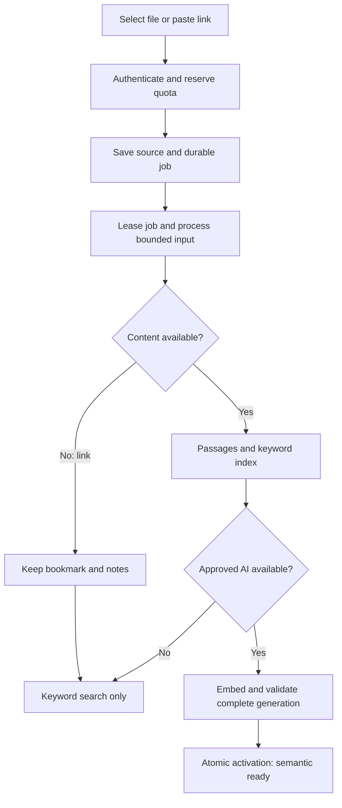
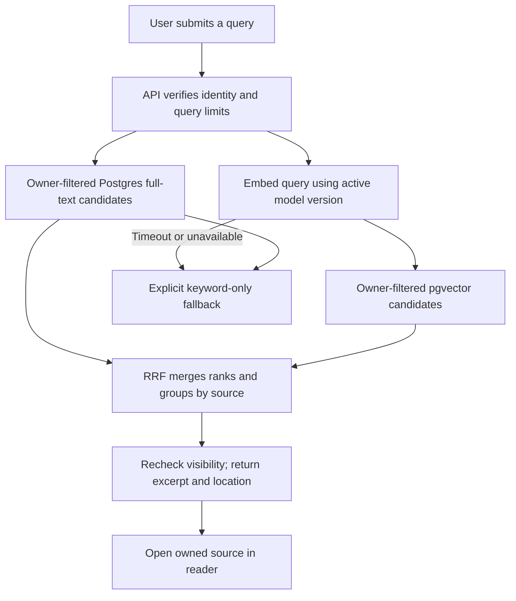

# Gather: search-first delivery plan

Date: 2 October 2026. Planning checkpoint, not a production-readiness claim.
Read alongside [PRD](PRD.md), [architecture](ARCHITECTURE.md), [tasks](../TASKS.md)
and [current state](MEMORY.md). New choices below are proposed implementation
defaults; accepted product constraints remain unchanged. No cloud purchase,
deployment, push or real-user upload is authorized by this document.

## 1. What we are building

A Windows desktop library where a person saves a file or public link, searches
using their own words, and opens the actual matching passage or image. Start
with TXT/Markdown and public webpages. Then add native-text PDF, DOCX, PPTX,
photos and OCR. Supported video links can contribute available metadata and
subtitles; that does not mean we understand the video's images or audio.
Selected-document chat comes after reliable search.

The first useful milestone is **save -> persist -> search -> open -> delete**.
Deliver an explicitly labelled keyword version while cloud AI is unavailable;
upgrade that same flow to measured semantic search when a provider is approved.
The first semantic milestone is not complete until real embeddings retrieve
real indexed content. Initial users remain an unvalidated Windows student/
knowledge-worker hypothesis. Test the flow with a few consenting pilot users
before broadening scope; record observed friction rather than inventing research.

## 2. What exists today

| Evidence | Actual scope |
| --- | --- |
| React/TypeScript + Tauri shell | Fixture library and reader; no real import or account |
| Python processing modules | Bounded TXT/MD, supplied HTML, extraction-output adapters, subtitle parsing and provenance |
| Retrieval evaluation | TF-IDF baseline, vector math/RRF tests, mocked embedding client; no measured model quality |
| Docker image | Crawl4AI and yt-dlp packages installed; offline runner tested; no live tool invocation or Chromium |
| Network policy | Public-address preflight tested with injected resolution; not enforced live egress |
| Last executed checks, 1 October | 98 tests and frontend quality/build checks passed; selected container probes passed |

Missing: durable library, API, authentication, owner isolation, job queue, live
fetching, cloud embeddings, connected semantic search and installer QA. This
planning change does not rerun or expand those implementation claims.

## 3. Target system and responsibilities

**Use a modular backend with an independently restricted extraction runtime.**
Keep modules in this repository; deploy only boundaries that need separate
permissions or scaling. Proposed API: Python FastAPI with explicit request/
response schemas, reusing existing pure Python processing functions. Do not
introduce Kubernetes, Kafka, Redis or an autonomous agent for the first release.

| Component | Owns | Must not do |
| --- | --- | --- |
| Tauri + React desktop | File selection, library, search, reader, status and recovery | Hold provider/admin secrets or silently upload personal folders |
| Supabase Auth | User sessions; verified identity | Substitute for authorization on individual records |
| Application API | Verify tokens, enforce owner/quota checks, coordinate saves, search and deletion | Trust a desktop-supplied owner ID or run parsers in HTTP handlers |
| Supabase Postgres | Sources, versions, passages, job ledger, usage and pgvector | Expose unfinished, deleted or another owner's content |
| Private Supabase Storage | Original files and explicitly retained derivatives | Use public buckets or permanent public download links |
| Trusted processing coordinator | Claim jobs, invoke sandbox, validate outputs, embed and publish index versions | Give database/inference credentials to the webpage/browser sandbox |
| Extraction sandbox + egress gateway | Bounded public-page/video-subtitle extraction | Reach LAN, loopback, metadata endpoints, private services or host mounts |
| Cloud model adapter | Approved text embeddings, later OCR/image encoders | Mix incompatible vector spaces or accept unbounded work |

All cloud boxes are targets. Supabase Free remains the chosen starting backend.
It has finite shared quotas, not a promise of free production at any scale
([pricing](https://supabase.com/pricing)). Chroma is a future contingency requiring
a migration decision, not a second database maintained alongside Supabase.

Proposed later hosting: Cloud Run service for HTTP requests, a triggered job for
bounded batch processing, and a separately enforced egress boundary. Cloud Run
supports distinct service/job execution modes; deployment configuration and
network policy must be proven on the chosen platform
([official overview](https://docs.cloud.google.com/run/docs/overview/what-is-cloud-run)).
This is a recommendation, not a provisioned service or zero-cost guarantee.
Persistent background work must not depend on an HTTP response staying open.
GKE becomes worth revisiting only with measured needs that simpler managed
containers cannot satisfy. Model hosting/GPU choice remains deferred.

## 4. Product flow and honest states

The core navigation stays Library -> Search results -> Source reader. Add a
small processing view and account/settings. Cloud setup is a service status
experience, not a request for end users to install model weights or Docker.
Keep the current Segoe UI, warm surfaces, restrained green and avoid list.

| Situation | What the person sees | Recovery |
| --- | --- | --- |
| File accepted | Saved; processing stage, no invented percentage | Cancel/delete; retry after actionable error |
| Link extraction unavailable | Link saved; notes/title only | Edit notes, open original, retry within limits |
| Keyword index committed | Keyword searchable | Explain when meaning search is unavailable |
| Embeddings committed | Meaning search available | Show actual matching passages and source locations |
| Provider unavailable | Keyword results with clear degraded-mode message | Retry; preserve existing data |
| No convincing matches | No useful matches, or clearly labelled related results | Change wording or filters; no made-up confidence percentages |
| Refresh running | Previous complete version remains searchable | Keep old version on refresh failure |
| Delete accepted | Removed from library/search; cleanup pending if necessary | Retry cleanup automatically, expose persistent failure |

Keyboard navigation, visible focus, screen-reader labels, reduced motion, narrow
windows and 200% scaling are release checks. Actual browser/native visual QA
remains pending under the existing access restriction.

## 5. Save and processing flow

1. Verify session, supported type and per-owner quota. Reserve capacity atomically.
   For files, issue a short-lived upload capability tied to one generated private
   object path and size policy; verify actual object size/content before processing.
   Expire abandoned reservations and remove orphan objects.
2. Save source/version and a job in one database transaction. For links, save the
   bookmark and notes before enrichment. Only public HTTP(S) is eligible to fetch.
3. A trusted worker claims the job with a lease. Proposed first queue is a private
   Postgres job table, using atomic claims and skip-locked rows; load-test it before
   scaling. A scheduled/triggered dispatcher recovers queued work after missed
   triggers; its hosting choice remains a deployment gate.
4. Run parsing/fetching under byte, time, memory and process limits. The sandbox
   receives only the job's bounded inputs. It returns typed text/metadata, never
   a shell command or instructions for the coordinator.
5. Preserve page, slide, field, timestamp or character references. Split into
   passages. Existing character chunks remain a prototype; use the chosen model's
   tokenizer before actual embedding and reject silent truncation.
6. Persist the complete extracted version and lexical index. Optionally publish
   keyword readiness. Embed with bounded batches through the approved provider,
   validate dimensions/counts/finite values, then persist all vectors.
7. Atomically activate a complete semantic index generation after verifying the
   source is not deleted and the worker still owns the current lease/generation.
   Partial writes stay invisible. Retire old generations after activation.

Delivery is **at least once**: a job may run again. Idempotency means that repeating
it creates the same version, not duplicate passages. Use owner-scoped idempotency
keys and hashes; never deduplicate across accounts in a way that reveals uploads.
Suggested starting retry policy: three transient attempts with exponential backoff
and jitter, lease heartbeat, then an actionable failed state. Validation failures
do not retry. Provider timeouts may have incurred cost: reconcile usage and use
provider idempotency when available rather than promise exactly-once billing.

## 6. Search and deletion flows

TF-IDF remains our reproducible offline comparator. Proposed production keyword
search uses Postgres full-text search with a GIN index and tested language
configuration. Add explicit title/identifier matching for punctuation-heavy names.
Combine lexical and vector rankings with reciprocal rank fusion (RRF), initially
the existing k=60 evaluation baseline, then tune against held-out queries. Rank
fusion combines positions rather than incomparable raw scores
([Supabase hybrid search](https://supabase.com/docs/guides/ai/hybrid-search)).

Start with exact vector search for correctness and measured small-library scale.
Introduce HNSW only when latency warrants it; compare owner-filtered recall
against exact search, including owners with very few records. Approximate indexes
trade recall for speed and filters can reduce returned matches
([pgvector documentation](https://github.com/pgvector/pgvector)).
Choose vector dimensions/operator/index compatibility after the model benchmark.
Text and SigLIP-style visual spaces remain separate, even at equal dimensions.
No final model winner is established; reuse the recorded shortlist, verify its
current license/runtime, and select on our corpus, latency and approved cost.

Deletion flow: authenticate -> transactionally tombstone source and cancel jobs ->
exclude it from every query/reader -> durable cleanup of objects, passages,
vectors and derivatives -> verify completion. Every worker publication checks
the tombstone and generation to prevent resurrection. Reconciliation sweeps
recover failed cleanup/orphans. Short-lived signed downloads already issued may
remain valid until expiry; disclose this limit, keep TTL small, and do not claim
instant revocation. Define backup expiry and reapply tombstones after restore.

## 7. Data model and invariants

Proposed schema, not migrations already applied:

| Entity | Key fields / invariant |
| --- | --- |
| sources | id, owner_id, kind, title, URL/object reference, deleted_at, active generation pointers |
| source_versions | source_id + owner_id, hash, extraction provenance, parser version, retention state |
| passages | version + owner, text, field/page/slide/time references, chunker version, full-text index |
| embedding_spaces | immutable model revision, tokenizer, prompts, dimension, normalization and modality |
| embeddings | passage + space + generation; exact dimension and unique identity enforced |
| jobs | owner/source/version, stage, attempts, lease token/expiry, next retry, safe error code |
| usage_reservations | atomic owner capacity/request reservations with expiry and reconciliation |

Carry owner IDs into composite foreign keys so a passage cannot reference another
owner's source. Separate lifecycle state, extraction coverage and search readiness:
metadata-only describes what was extracted, not whether notes have been indexed.
Published generations are immutable. A model change creates a new index and a
controlled pointer switch, with rollback to the previous compatible generation.

## 8. Security controls with proof obligations

| Risk | Planned enforcement | Test required before enabling it |
| --- | --- | --- |
| Cross-user data access | RLS, composite ownership constraints, private buckets, security-invoker search; derive identity from verified token | Two accounts attack list/read/search/update/delete/job/storage/RPC paths, including guessed IDs |
| Privileged worker bypass | Narrow worker role or restricted server functions, job-derived owner, no unrestricted user-supplied query | Try mismatched owner/job and forbidden writes; verify extraction sandbox has no credentials |
| Token/key theft | Validate signature, issuer, audience, expiry; approved login flow; OS-backed session storage; provider secrets server-only | Expiry/rotation/logout/callback replay tests and built-bundle secret scan |
| Quota bypass | Atomic reservations and guarded write functions; no direct client permission to forge ready state, jobs or usage | Call Supabase directly, bypass UI/API; concurrent requests cannot exceed quota |
| Malicious link/SSRF | Forced egress gateway, connect only to checked public IP, verify TLS hostname, revalidate redirects and every subresource/subtitle URL | Private/mixed IPv4/IPv6, metadata, DNS rebinding, redirects, browser/WebSocket/UDP bypass attempts |
| Hostile parsers/pages | Non-root sandbox, no secrets/mounts, read-only filesystem, bounded temp space and supervisor killing process tree | Malformed documents, archive bombs, hangs, decompression limits and sandbox escape surface review |
| Content execution | Safe text/Markdown renderer; no remote HTML in privileged Tauri webview; narrow CSP/IPC | Script/event-handler links, malicious filenames, path traversal and unsafe external schemes |
| Sensitive logs | Allowlisted IDs/status/timing only; no content, queries, URL tokens or signed URLs; restricted retention/access | Canary secrets and fixture content must not appear in logs or crash reports |
| Supply chain | Base digest and hash-locked dependencies, licenses/SBOM, vulnerability review, deliberate updates | Rebuild from lock; verify artifacts; remediate or explicitly triage findings |
| Cost/resource abuse | Server-side file/query/job/token/concurrency caps, provider circuit breaker and application spend cutoff | Concurrent abuse, provider outage and exhausted budget tests |

RLS does not protect queries made with a bypass role. Supabase service/secret keys
must never reach the desktop, and server privileges need separate controls
([Supabase RLS](https://supabase.com/docs/guides/database/postgres/row-level-security)).
URL validation alone cannot prevent SSRF; DNS and actual connection enforcement
must agree ([OWASP SSRF guidance](https://cheatsheetseries.owasp.org/cheatsheets/Server_Side_Request_Forgery_Prevention_Cheat_Sheet.html)).
Tauri permissions must remain scoped to intended windows and commands
([capabilities](https://v2.tauri.app/security/capabilities/)).

No public fetching before egress tests pass. No shared-cookie scraping, CAPTCHA
bypass, private social-session import or promise to scrape every site. Respect
site access constraints; show saved-only fallback. Review audience, operator,
region, processor retention, final notices and deletion policy before accounts/
real uploads using [the existing release audit](PRIVACY_RELEASE_AUDIT.md).

## 9. Ordered delivery and exit gates

| Order / task | Build | Evidence required to advance |
| --- | --- | --- |
| 1 / TASK-019A | Lock extractor base image, transitive packages and browser dependency plan | Reproducible build, package/license inventory, vulnerability triage, existing smoke passes |
| 2 / TASK-019B | Enforced egress and bounded supervisor | Rebinding/redirect/subresource/bypass tests fail closed; kill/retry cleans child processes |
| 3 / TASK-019C | Invoke Crawl4AI and yt-dlp on approved public test pages | Actual versioned outputs, provenance, transcript/metadata distinction, limits and saved-only failure fallback |
| 4 / TASK-021 | Local Supabase schema, job state and security contracts | Fresh migrations; two-user RLS/Storage/RPC and quota tests; retry/delete race tests with synthetic content |
| 5 / TASK-006, 007, 017 | Auth/API/desktop save-to-keyword-search vertical slice | Restart preserves data; import/link -> find -> open -> delete works; release gates before real accounts/data |
| 6 / TASK-005, 007 | Approved provider benchmark and real semantic integration | Tokenizer/version checks, measured recall/cost/latency; paraphrase retrieval; honest outage fallback |
| 7 / TASK-008 | Native PDF, DOCX and PPTX one format at a time | Page/slide provenance, malformed/long files, parser sandbox; scanned pages clearly detected |
| 8 / TASK-009 | OCR plus image/text embedding space | Measured photo/OCR query set, correct source image/region and separate-space fusion |
| 9 / TASK-003, 011–015 | Accessibility, installer, staging, recovery and release review | Clean Windows flow; two-user adversarial checks; restore drill; no critical unresolved security issue |
| Later / TASK-010 | Selected-source chat | Scoped retrieval, real citations, evidence absence, injection/cancellation tests |

Steps 1–4 can progress with synthetic data and local tools without a paid AI
account. Step 5 can be tested locally; external signup/upload needs the existing
privacy inputs. Step 6 requires provider, retention, budget and model approval.
Do not mark it done with fixtures. User input on those external gates should be
requested when needed; it need not block independent work now.

TASK-021's local persistence work may proceed if live-site testing is blocked;
do not let perfect scraper coverage delay the file search core. User testing
(TASK-002) and accessibility review accompany each usable slice. Keep each slice
small: read -> plan -> implement -> test -> review -> fix -> local commit ->
update notes. Push only on explicit instruction.

## 10. Performance, operations and release evidence

Initial proposed pilot limits: retain the current 64 KiB TXT/MD input boundary,
one processing job per owner, bounded global concurrency, query length cap and
bounded candidate/result counts. Derive larger Office/PDF limits and numeric
daily quotas from measured resource use and approved capacity, not guesses.
Use batching, owner-scoped deduplication, pagination, submit-based search and
stale-response cancellation. Add caches only after profiling; any future key
must include owner, query and active index/model generation and honor deletion.

Existing targets remain targets: text Recall@5 >=90% on a versioned answerable
set; warm search p95 <2 seconds on a documented 10,000-chunk setup. Report cold
start, embedding time, network and database latency separately. Expand beyond
the tiny development corpus with independently reviewed held-out paraphrases,
late passages, identifiers, bookmarks and absent queries. Compare TF-IDF,
production full-text, vector-only and hybrid; report per-category results and
false positives, not just an aggregate. Photo/OCR gets its own evaluation.

Operational signals: job age/depth, retries/failures, search p95, provider errors,
token/byte usage, quota rejections and cleanup backlog. Keep them content-free;
optional product analytics stays absent. Define alerts, retention, backup/export
coverage and a tested restore procedure before launch. Budget alerts are not
spend enforcement; the API must stop new expensive work at its configured cap.

Use local development -> isolated staging -> clean-machine QA -> limited pilot
-> public release. Keep environments/secrets separate. Prefer backward-compatible
schema changes, pinned images and rollbackable index generations. Restore drills
must include Storage originals as well as database rows and deletion tombstones.
Set concrete recovery-time/data-loss objectives once backup/deployment options
are chosen; none are currently guaranteed. A distributed installer needs a signing
decision and verified update integrity. Do not report native QA from browser tests.

## Immediate next task

3 October checkpoint: TASK-019A locked build, package inventory, offline smoke,
hash-rejection probe and full image scan completed. TASK-023 is next: remediate
and review scan findings. Available patches and runtime installer removal are
verified; the rescan has 31 records (four high), down from 51. Evidence and acceptance
are in services/worker/IMAGE_SCAN_REVIEW.md and TASKS.md. Keep networking disabled.
TASK-019B enforced egress and production supervision can proceed with local
isolation tests; live invocation requires closing the remaining security gates. The smoke harness timeout cleanup does not implement that service.
OKF remains optional later work (ADR-029). No cloud AI account is required here.
